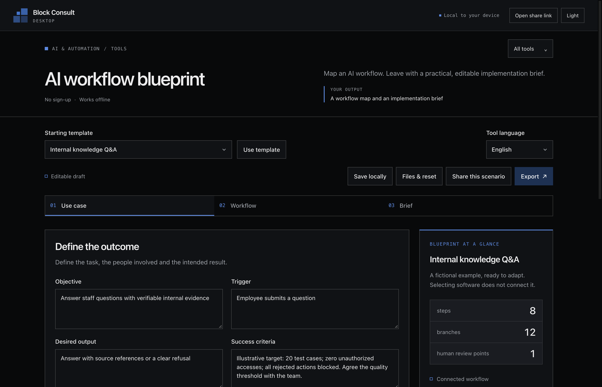
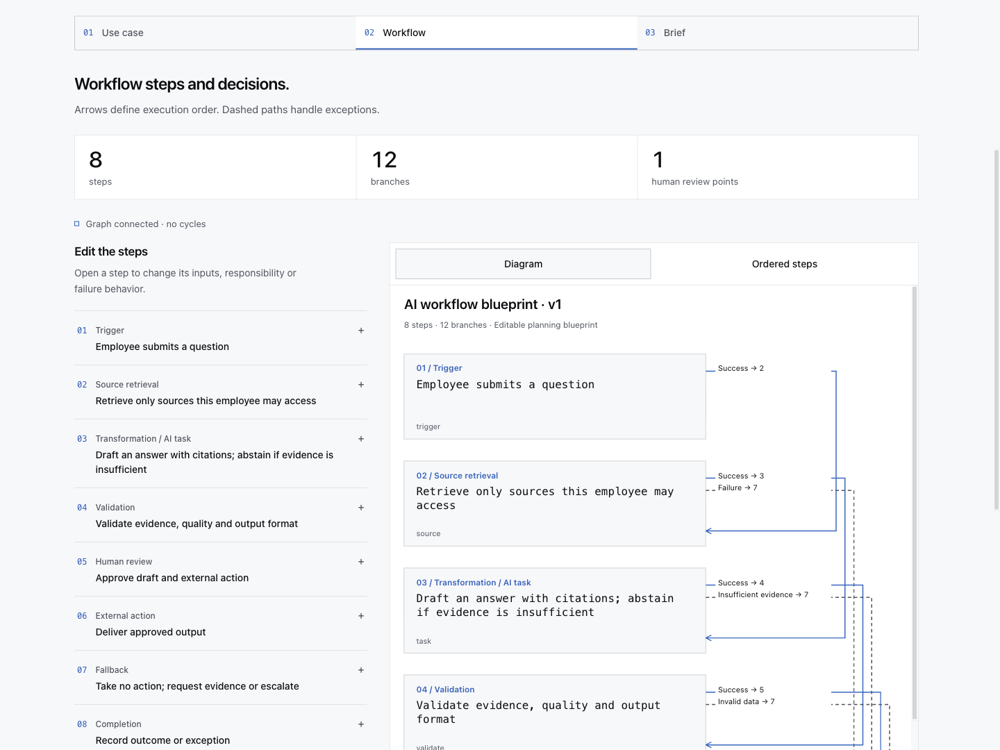

<a href="https://www.blockconsult.org">
  <picture>
    <source media="(prefers-color-scheme: dark)" srcset="public/blockconsult-logo.png">
    
  </picture>
</a>

# AI Workflow Blueprint

Turn an AI use case into a workflow your team can review and build. Define the intended outcome, map steps and decision branches, assign responsibilities and approvals, then export an editable implementation brief and workflow diagram.

An offline desktop tool from [Block Consult](https://www.blockconsult.org), available in English and German, with light and dark themes.

[](https://github.com/blockconsult-org/ai-workflow-blueprint/releases/latest) [](LICENSE) · [Platform builds](https://github.com/blockconsult-org/ai-workflow-blueprint/actions/workflows/release.yml)

**[Download for macOS or Windows](https://github.com/blockconsult-org/ai-workflow-blueprint/releases/latest)** · [Use in your browser](https://www.blockconsult.org/tools/ai-workflow-blueprint) · [Report an issue](https://github.com/blockconsult-org/ai-workflow-blueprint/issues)



## What you can do

- Start from internal knowledge Q&A, enquiry triage, document extraction, proposal drafting or recurring reporting templates.
- Define the objective, scope, source data, intended software, owners, success criteria and authorization conditions.
- Edit up to twenty workflow steps, including source retrieval, AI tasks, validation, human review, external actions and failure paths.
- Review a connected workflow diagram and ordered steps. Graph checks expose cycles, missing connections and approval-path problems.
- Edit the generated implementation brief. Manual sections retain your wording and are flagged for review when their inputs change.
- Export diagrams as SVG or PNG, the brief as Markdown or PDF, and the complete editable model as JSON.

## Get started

1. Choose a **Starting template** and select **Use template**, or begin with the loaded internal knowledge Q&A example.
2. Complete **Use case**, including the intended outcome, source rights, owner and approval conditions.
3. Open **Workflow** to edit steps, branches, responsibility and failure behavior; then review **Brief** and resolve the reported issues.
4. Use **Save locally** to keep a draft, or **Export** to save the editable JSON, diagram or implementation brief.

## Screenshots



The built-in internal knowledge Q&A workflow shows source access checks, human review and exception paths. It is an editable plan; no software is connected or executed. Both screenshots show the actual desktop app with fictional example data or its starting workspace.

## Download and install

| Platform | Download | Installation |
| --- | --- | --- |
| macOS, Apple silicon and Intel | Universal `.dmg` | Open the disk image and drag the app to Applications. |
| Windows 11, Intel/AMD 64-bit | `windows-x64-setup.exe` | Run the per-user installer; administrator rights are not required. |
| Windows, portable | `windows-x64-portable.exe` | Run directly without installing. |

Release notes state the signing and notarization status of each download. Unsigned Windows releases may show a publisher warning. macOS requires macOS 13 or later. Check `SHA256SUMS.txt` against the downloaded file using `shasum -a 256` (macOS) or `Get-FileHash -Algorithm SHA256` (PowerShell). Download only from this repository's Releases page.

## Your data

Calculations and editing run locally without an internet connection, account or API key. The app has no analytics, telemetry, cloud synchronization or automatic uploads.

Use **Save locally** to keep a draft in this app, or **Export → Export JSON** to keep every input, branch and manual brief edit in a portable file. Save explicitly before closing. Shared snapshots open read-only, and making a copy does not replace your saved draft until you save it.

JSON models and browser share links are compatible with the Block Consult browser tool. **Open share link** lets you inspect a shared scenario in the desktop app. Save or export before opening a share link; navigation replaces the open workspace. Share links contain readable, encoded snapshots and are not encrypted. Review the sharing preview and the option to include authored text before creating one.

Exports use native file-save dialogs. **File → Save report as PDF** saves a local PDF. Website and evidence links open in your default browser; unknown evidence destinations require confirmation.

## Run from source

Install Node.js 24 or newer, then:

```sh
git clone https://github.com/blockconsult-org/ai-workflow-blueprint.git
cd ai-workflow-blueprint
npm ci
npm run build
npm start
```

`npm run dev` runs the renderer in a browser. `npm test` checks the model and desktop security boundaries. `npm run test:desktop` launches real Electron and exercises offline rendering, themes, localization, exports and isolation. Run `npm run build` first.

```sh
npm run verify
npm run dist -- --mac --universal  # on macOS
npm run dist -- --win --x64       # on Windows
```

## Project layout

| Path | Responsibility |
| --- | --- |
| `tools/ai-workflow-blueprint/` | Models, calculations, localized copy, UI and exports |
| `src/` | Desktop frame and small browser-framework adapters |
| `desktop/` | Sandboxed Electron host, local asset protocol, native PDF saving |
| `tests/` | Calculation regressions and real desktop integration checks |
| `.github/workflows/release.yml` | Tests and platform builds; draft releases for version tags |

## Release and maintenance

See the [release instructions](docs/RELEASING.md). Releases are manual downloads; the app does not silently update. Keep the Electron runtime current when maintaining a fork.

This is a deterministic planning tool with authored templates. It does not run an AI model, connect software or execute a workflow. A connected graph does not establish production readiness; agree permissions, test targets and ownership with your team.

## Contributing and license

Read the [contribution guide](CONTRIBUTING.md) before opening a pull request. Report vulnerabilities privately through the [security policy](SECURITY.md).

[MIT](LICENSE) · Copyright © 2026 Block Consult GmbH. The license covers the code; it does not grant rights to use Block Consult’s name or logo as an endorsement.
